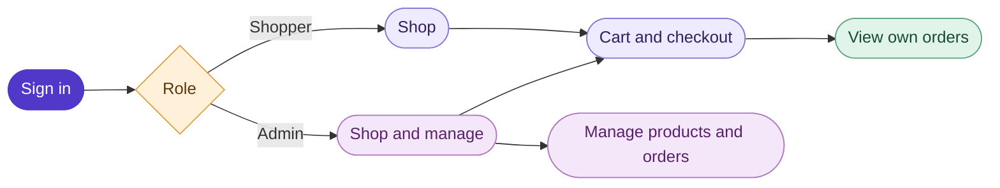
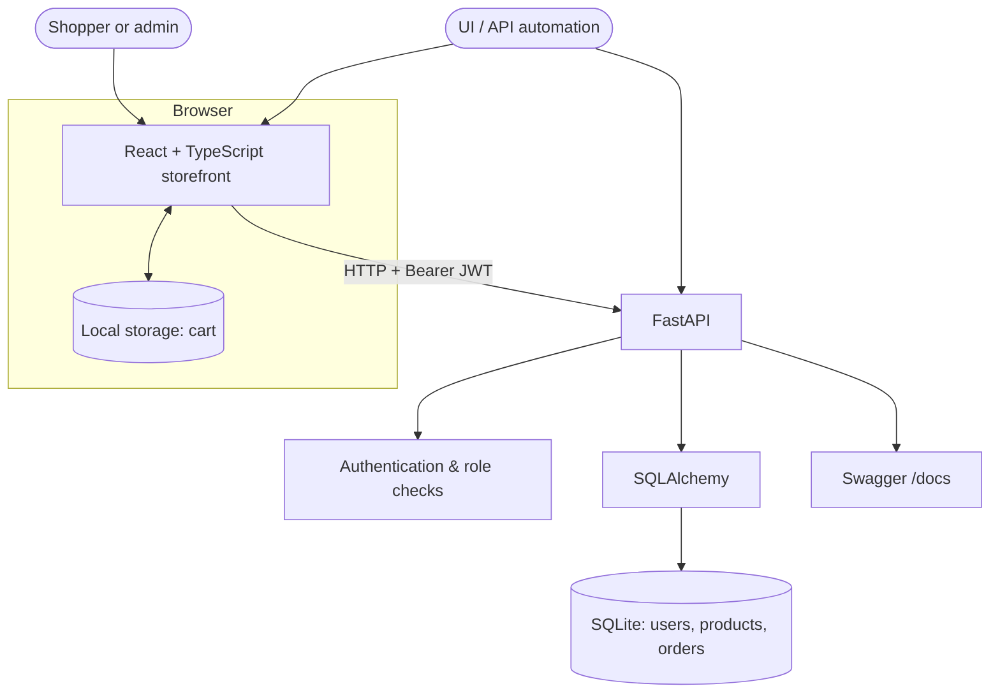

<div align="center">

# Everyday Store

### A small store. A complete automation playground.

Browse products, fill a cart, place simulated orders, and manage a store — all on your machine.
Built for humans to explore and for UI and API automation tools to exercise.


**[Get started](#get-started)** · **[Explore the app](#explore-the-app)** · **[Architecture](#architecture)** · **[Agent guidance](#agent-guidance)**

</div>

---

## Explore the app

| 🛍️ Shop | 📦 Order | 🛠️ Administer | 🧪 Automate |
|---|---|---|---|
| Search products, add items, and adjust quantities. | Place a simulated order with delivery preferences and an optional attachment. | Manage products, review orders, and update their status. | Exercise the UI and API using Selenium, Playwright, or your preferred tools. |

The app includes text and number inputs, checkboxes, radio buttons, date and file inputs, a dropdown, confirmation dialogs, notifications, tooltips, and order tables. Interactive controls have `data-testid` attributes for stable selectors.



> **Simulated store:** prices are shown in Indian rupees (INR). No real payment or delivery takes place.

## Architecture



The cart stays in browser storage; adding or removing items does not call the API. Checkout sends `POST /orders`, and the backend calculates the total from current product prices. Each order retains product names and prices as they were at checkout. Optional attachments, up to 1 MB, are stored with the order in SQLite.

### Technology

| Layer | Technology | Purpose |
|---|---|---|
| Frontend | React, TypeScript, Vite, shared CSS | Responsive storefront and admin interface |
| Backend | Python, FastAPI, Pydantic | Shopping API and request validation |
| Data | SQLAlchemy, SQLite | Local persistence without a separate database server |
| Authentication | JWT Bearer tokens | Sign-in and role-based access |
| API exploration | Swagger UI | Interactive API documentation at `/docs` |
| Automation | Selenium, Playwright, or other tools | UI and API testing; no framework required by the app |

## Get started

**Prerequisites:** Python 3.10+ and Node.js 18+. Run the backend and frontend in separate terminals.

**1. Start the API**

```powershell
cd backend
python -m venv .venv
.venv\Scripts\Activate.ps1
pip install -r requirements.txt
uvicorn main:app --reload --port 8000
```

**2. Start the storefront**

```powershell
cd frontend
npm install
npm run dev
```

| Service | Address |
|---|---|
| Storefront | [http://localhost:5173](http://localhost:5173) |
| API health | [http://localhost:8000/health](http://localhost:8000/health) |
| Interactive API docs | [http://localhost:8000/docs](http://localhost:8000/docs) |

### Demo accounts

| Role | Username | Password | Access |
|---|---|---|---|
| Shopper | `shopper` | `shopper123` | Shop and view own orders |
| Second shopper | `shopper2` | `shopper123` | Test separation between shoppers |
| Admin | `admin` | `admin123` | Shop, manage products, and manage all orders |

Accounts and sample products are seeded when the app initializes. The default database is `backend/shop.sqlite3`; existing shopping data is preserved on restart.

### Configuration

| Variable | Purpose | Default |
|---|---|---|
| `VITE_API_BASE_URL` | Frontend API origin | Current browser host on port `8000` |
| `JWT_SECRET_KEY` | JWT signing key | A development-only key |
| `SHOP_DB_PATH` | SQLite database file | `backend/shop.sqlite3` |

Use a separate `SHOP_DB_PATH` for tests that create or modify data. The demo credentials, default signing key, and simulated checkout are intended for local practice.

## Project map

```text
practice-app/
├── frontend/                 React storefront and shared styles
│   ├── src/App.tsx           Shopping views, requests, and cart behavior
│   └── src/index.css         Shared visual system
├── backend/
│   ├── main.py               FastAPI endpoints and SQLAlchemy models
│   ├── auth.py               JWT authentication and authorization
│   ├── models.py             Request schemas
│   └── shop.sqlite3          Local data, created on first run
├── scripts/check-test-ids.js Interactive-control selector check
├── AGENTS.md                 Project-wide agent instructions
└── .agents/skills/           Reusable frontend and backend workflows
```

## Agent guidance

The repository includes instructions for coding agents and contributors. They document the app's conventions and repeatable workflows; they do not replace the user's request.

| File | When to use it |
|---|---|
| [AGENTS.md](AGENTS.md) | Project-wide conventions, permissions, and checks |
| [backend/AGENTS.md](backend/AGENTS.md) | Backend authorization, data, and API guidance |
| [frontend/AGENTS.md](frontend/AGENTS.md) | Frontend accessibility, styling, and testing guidance |
| [backend-workflow/SKILL.md](.agents/skills/backend-workflow/SKILL.md) | Reusable workflow for backend, authentication, or database changes |
| [frontend-workflow/SKILL.md](.agents/skills/frontend-workflow/SKILL.md) | Reusable workflow for storefront and UI changes |

Project-wide guidance applies across the repository; nested `AGENTS.md` files add guidance for their directories. In a skill-aware coding agent, the skills can be selected when relevant or invoked explicitly as `$backend-workflow` or `$frontend-workflow`.

## Validation

Run these from the repository root:

```powershell
python -m py_compile backend/main.py backend/auth.py backend/models.py
npm run build --prefix frontend
node scripts/check-test-ids.js
```

For behavior changes, also exercise the affected UI or API flows and check shopper/admin permissions. Use an isolated database for tests that write data.
